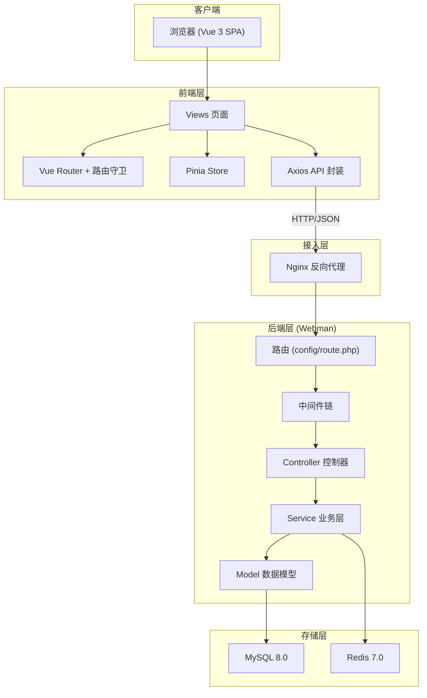
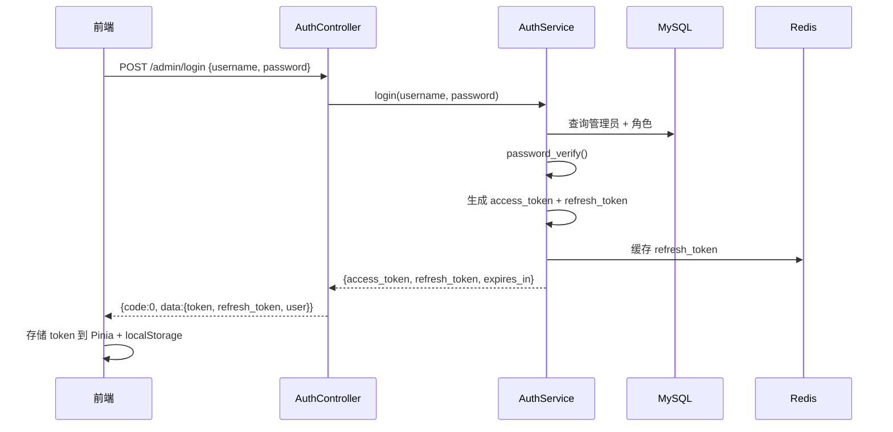
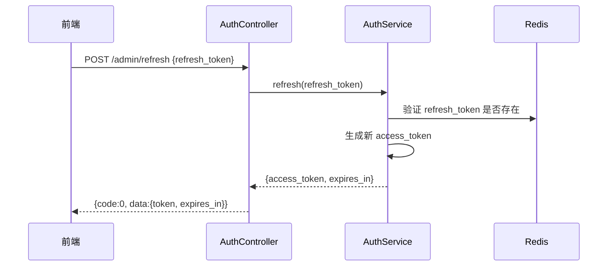
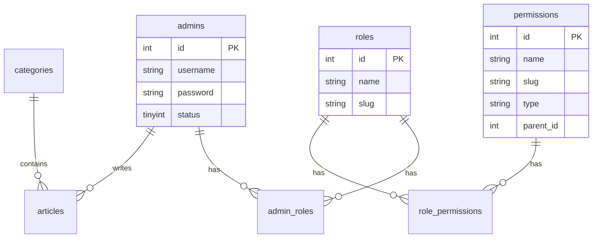
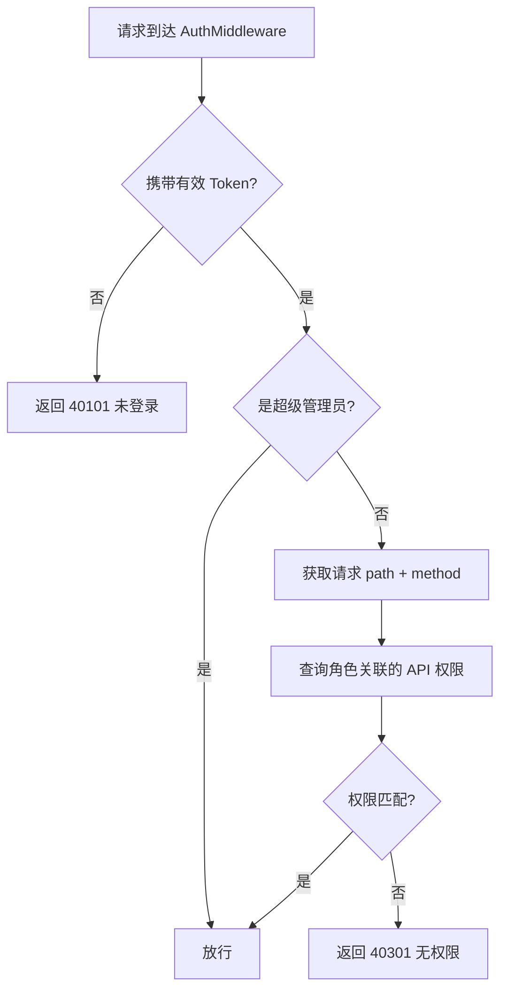
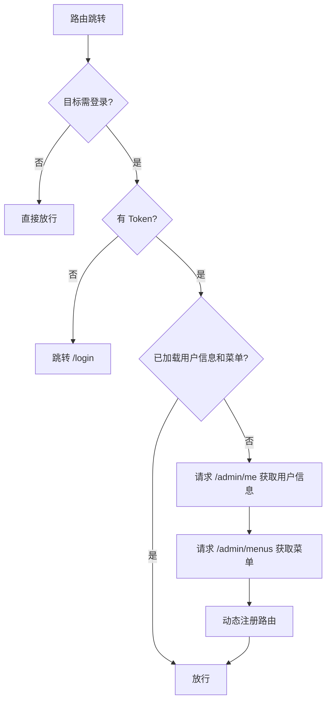

# 系统架构设计

## 一、整体架构



## 二、后端分层架构

```
Request
  │
  ▼
┌─────────────────────────────────────────┐
│  Middleware 中间件链                      │
│  CorsMiddleware → AuthMiddleware → ...  │
└─────────────────────────────────────────┘
  │
  ▼
┌─────────────────────────────────────────┐
│  Controller 控制器                       │
│  参数接收、校验、调用 Service、返回响应    │
└─────────────────────────────────────────┘
  │
  ▼
┌─────────────────────────────────────────┐
│  Service 业务逻辑层                        │
│  业务规则、事务处理、异常抛出               │
└─────────────────────────────────────────┘
  │
  ▼
┌─────────────────────────────────────────┐
│  Model 数据模型 (Eloquent ORM)           │
│  数据访问、关联关系、作用域                 │
└─────────────────────────────────────────┘
  │
  ▼
 MySQL / Redis
```

### 各层职责

| 层级 | 职责 | 命名规范 |
|------|------|----------|
| Controller | 接收请求、参数校验、调用 Service、格式化响应 | `XxxController` |
| Service | 业务逻辑、事务管理、权限业务判断 | `XxxService` |
| Model | 数据表映射、关联定义、查询作用域 | `Xxx`（单数） |
| Middleware | 跨域、认证、权限、日志 | `XxxMiddleware` |

### 目录映射

```
app/
├── admin/controller/     # 后台管理接口
│   ├── AuthController.php
│   ├── AdminController.php
│   ├── RoleController.php
│   ├── PermissionController.php
│   ├── ArticleController.php
│   └── SettingController.php
├── api/controller/       # 前端公共接口
│   └── ArticleController.php
├── service/
│   ├── AuthService.php
│   ├── AdminService.php
│   ├── RoleService.php
│   ├── PermissionService.php
│   ├── ArticleService.php
│   └── SettingService.php
├── model/
│   ├── Admin/
│   │   ├── AdminModel.php
│   │   ├── RoleModel.php
│   │   ├── PermissionModel.php
│   │   ├── AdminRoleModel.php
│   │   ├── RolePermissionModel.php
│   │   └── DepartmentModel.php
│   ├── Content/
│   │   ├── ArticleModel.php
│   │   └── CategoryModel.php
│   ├── System/
│   │   ├── SettingModel.php
│   │   ├── DictTypeModel.php
│   │   └── DictItemModel.php
│   ├── Monitor/
│   │   ├── AdminLogModel.php
│   │   ├── AdminIpWhitelistModel.php
│   │   └── AdminNotificationModel.php
│   └── Concerns/
│       └── DefinesTableSchema.php
└── middleware/
    ├── CorsMiddleware.php
    ├── AuthMiddleware.php
    └── AdminLogMiddleware.php
```

## 三、认证流程

### 3.1 登录流程



### 3.2 JWT Payload 结构

```json
{
  "iss": "webman-admin",
  "sub": 1,
  "admin_id": 1,
  "username": "admin",
  "roles": ["super_admin"],
  "iat": 1700000000,
  "exp": 1700007200
}
```

| 字段 | 说明 |
|------|------|
| `admin_id` | 管理员 ID |
| `username` | 用户名 |
| `roles` | 角色标识数组 |
| `exp` | 过期时间（access_token 默认 2 小时） |

### 3.3 Token 刷新流程



### 3.4 Token 策略

| Token 类型 | 有效期 | 存储位置 | 用途 |
|------------|--------|----------|------|
| access_token | 2 小时 | 前端 Pinia + localStorage | API 请求认证 |
| refresh_token | 7 天 | 前端 localStorage + Redis | 刷新 access_token |

### 3.5 密码安全

- 使用 `password_hash($password, PASSWORD_BCRYPT)` 加密存储
- 使用 `password_verify()` 验证
- 登录失败不区分「用户不存在」和「密码错误」，统一返回「用户名或密码错误」

## 四、RBAC 权限模型

### 4.1 模型关系



### 4.2 权限类型

| type | 说明 | 示例 |
|------|------|------|
| `menu` | 侧边栏菜单 | 文章管理、系统设置 |
| `button` | 页面按钮 | 新增文章、删除文章 |
| `api` | 后端接口 | `GET /admin/articles` |

### 4.3 权限校验流程



### 4.4 超级管理员

- 角色 `slug = super_admin` 拥有所有权限，跳过 API 权限校验
- 系统初始化时创建，不可通过界面删除
- 至少保留一个超级管理员账号

### 4.5 权限标识 (slug) 规范

```
模块:操作

示例:
  article:list      → GET  /admin/articles
  article:create    → POST /admin/articles
  article:update    → PUT  /admin/articles/{id}
  article:delete    → DELETE /admin/articles/{id}
  admin:list        → GET  /admin/admins
  role:assign       → PUT  /admin/roles/{id}/permissions
```

### 4.6 权限与路由映射

`permissions` 表中 `type = api` 的记录通过 `path` + `method` 字段与路由匹配：

| permission.slug | path | method |
|-----------------|------|--------|
| article:list | /admin/articles | GET |
| article:create | /admin/articles | POST |
| article:update | /admin/articles/* | PUT |
| article:delete | /admin/articles/* | DELETE |

> 路径中的 `*` 表示通配单个路径段。

## 五、前端架构

### 5.1 目录结构

```
frontend/src/
├── api/                  # API 请求（按模块拆分）
│   ├── base.ts           # Axios 实例与拦截器
│   ├── auth.ts
│   ├── admin.ts
│   ├── role.ts
│   ├── permission.ts
│   ├── article.ts
│   └── setting.ts
├── stores/
│   ├── user.ts           # 用户信息、Token、权限
│   └── permission.ts     # 动态路由、菜单
├── router/
│   ├── index.ts
│   └── permission.ts     # 路由守卫
├── views/
│   ├── login/
│   ├── dashboard/
│   ├── system/           # 管理员、角色、权限
│   ├── article/
│   └── setting/
├── types/                # TypeScript 类型定义
└── utils/
    └── permission.ts     # 按钮权限指令 v-permission
```

### 5.2 路由守卫流程



### 5.3 按钮权限

前端通过自定义指令 `v-permission` 控制按钮显示：

```vue
<el-button v-permission="'article:delete'" type="danger" @click="handleDelete">
  删除
</el-button>
```

`userStore.permissions` 存储当前用户拥有的权限 slug 列表，由 `/admin/me` 接口返回。

### 5.4 动态菜单

1. 登录后请求 `GET /admin/menus`
2. 后端返回 `type = menu` 的权限树
3. 前端转换为 Vue Router 路由配置并动态注册
4. 侧边栏根据菜单树渲染

## 六、中间件链

### 6.1 全局中间件

```
CorsMiddleware          → 处理跨域
```

### 6.2 后台路由中间件

```
AuthMiddleware          → JWT 验证 + API 权限校验
AdminLogMiddleware      → 记录操作日志（POST/PUT/DELETE）
```

### 6.3 路由分组示例

```php
// config/route.php

// 无需认证
Route::post('/admin/login', [AuthController::class, 'login']);
Route::post('/admin/refresh', [AuthController::class, 'refresh']);

// 需要认证
Route::group('/admin', function () {
    Route::post('/logout', [AuthController::class, 'logout']);
    Route::get('/me', [AuthController::class, 'me']);
    Route::get('/menus', [AuthController::class, 'menus']);

    // 管理员
    Route::get('/admins', [AdminController::class, 'index']);
    Route::post('/admins', [AdminController::class, 'store']);
    // ...

    // 文章
    Route::get('/articles', [ArticleController::class, 'index']);
    // ...
})->middleware([AuthMiddleware::class, AdminLogMiddleware::class]);
```

## 七、缓存策略

| 缓存 Key | 数据 | TTL | 失效时机 |
|----------|------|-----|----------|
| `admin:permissions:{admin_id}` | 用户权限 slug 列表 | 1 小时 | 角色变更时清除 |
| `admin:menus:{admin_id}` | 用户菜单树 | 1 小时 | 权限变更时清除 |
| `refresh_token:{token}` | refresh_token 有效性 | 7 天 | 登出 / 刷新时删除 |
| `setting:{key}` | 系统配置项 | 24 小时 | 配置更新时清除 |

## 八、错误处理

### 统一异常处理

```php
// app/exception/Handler.php
try {
    // 业务逻辑
} catch (BusinessException $e) {
    return json(['code' => $e->getCode(), 'msg' => $e->getMessage(), 'data' => null]);
} catch (\Exception $e) {
    return json(['code' => 50000, 'msg' => '服务器内部错误', 'data' => null], 500);
}
```

### 错误码分段

| 范围 | 模块 |
|------|------|
| 0 | 成功 |
| 401xx | 认证相关 |
| 403xx | 权限相关 |
| 404xx | 资源不存在 |
| 422xx | 参数校验 |
| 500xx | 服务器错误 |

详见 [API.md](./API.md#错误码)。

## 九、日志与审计

### 操作日志 (admin_logs)

自动记录以下操作：

- 管理员 CRUD
- 角色 / 权限变更
- 文章 CRUD
- 系统配置修改

记录字段：操作人、模块、动作、请求参数、IP、User-Agent、时间。

### 应用日志

使用 Webman 内置 Monolog，日志文件位于 `runtime/logs/`。
