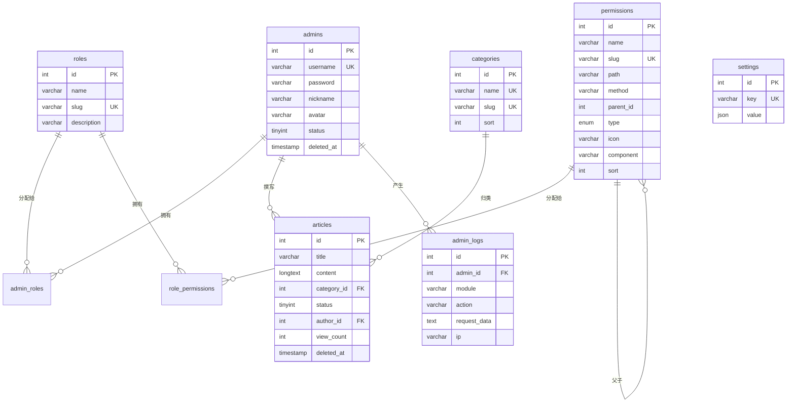

# 数据库设计

## 概述

- 数据库：MySQL 8.0+
- 字符集：`utf8mb4`
- 排序规则：`utf8mb4_unicode_ci`
- 存储引擎：InnoDB
- 时间字段：统一使用 `TIMESTAMP`，自动维护 `created_at` / `updated_at`
- 软删除：核心业务表使用 `deleted_at` 字段

## ER 关系图



---

## 表结构

### admins — 管理员表

```sql
CREATE TABLE admins (
    id INT UNSIGNED AUTO_INCREMENT PRIMARY KEY,
    username VARCHAR(50) NOT NULL COMMENT '用户名',
    password VARCHAR(255) NOT NULL COMMENT '密码 (bcrypt)',
    nickname VARCHAR(50) DEFAULT '' COMMENT '昵称',
    avatar VARCHAR(255) DEFAULT '' COMMENT '头像 URL',
    status TINYINT UNSIGNED DEFAULT 1 COMMENT '状态: 1-启用 0-禁用',
    deleted_at TIMESTAMP NULL DEFAULT NULL COMMENT '软删除时间',
    created_at TIMESTAMP DEFAULT CURRENT_TIMESTAMP,
    updated_at TIMESTAMP DEFAULT CURRENT_TIMESTAMP ON UPDATE CURRENT_TIMESTAMP,
    UNIQUE KEY uk_username (username),
    KEY idx_status (status),
    KEY idx_deleted_at (deleted_at)
) ENGINE=InnoDB DEFAULT CHARSET=utf8mb4 COLLATE=utf8mb4_unicode_ci COMMENT='管理员表';
```

### roles — 角色表

```sql
CREATE TABLE roles (
    id INT UNSIGNED AUTO_INCREMENT PRIMARY KEY,
    name VARCHAR(50) NOT NULL COMMENT '角色名称',
    slug VARCHAR(50) NOT NULL COMMENT '角色标识',
    description VARCHAR(255) DEFAULT '' COMMENT '描述',
    created_at TIMESTAMP DEFAULT CURRENT_TIMESTAMP,
    updated_at TIMESTAMP DEFAULT CURRENT_TIMESTAMP ON UPDATE CURRENT_TIMESTAMP,
    UNIQUE KEY uk_slug (slug)
) ENGINE=InnoDB DEFAULT CHARSET=utf8mb4 COLLATE=utf8mb4_unicode_ci COMMENT='角色表';
```

### permissions — 权限表

```sql
CREATE TABLE permissions (
    id INT UNSIGNED AUTO_INCREMENT PRIMARY KEY,
    name VARCHAR(50) NOT NULL COMMENT '权限名称',
    slug VARCHAR(100) NOT NULL COMMENT '权限标识',
    path VARCHAR(200) DEFAULT '' COMMENT '路由路径 (menu/api)',
    method VARCHAR(10) DEFAULT '' COMMENT 'HTTP 方法 (api)',
    parent_id INT UNSIGNED DEFAULT 0 COMMENT '父级 ID, 0 为顶级',
    type ENUM('menu', 'button', 'api') NOT NULL DEFAULT 'api' COMMENT '权限类型',
    icon VARCHAR(50) DEFAULT '' COMMENT '菜单图标',
    component VARCHAR(200) DEFAULT '' COMMENT '前端组件路径',
    sort INT DEFAULT 0 COMMENT '排序 (升序)',
    hidden TINYINT UNSIGNED DEFAULT 0 COMMENT '是否隐藏: 0-显示 1-隐藏',
    created_at TIMESTAMP DEFAULT CURRENT_TIMESTAMP,
    updated_at TIMESTAMP DEFAULT CURRENT_TIMESTAMP ON UPDATE CURRENT_TIMESTAMP,
    UNIQUE KEY uk_slug (slug),
    KEY idx_parent_id (parent_id),
    KEY idx_type (type)
) ENGINE=InnoDB DEFAULT CHARSET=utf8mb4 COLLATE=utf8mb4_unicode_ci COMMENT='权限表';
```

### admin_roles — 管理员角色关联表

```sql
CREATE TABLE admin_roles (
    admin_id INT UNSIGNED NOT NULL,
    role_id INT UNSIGNED NOT NULL,
    PRIMARY KEY (admin_id, role_id),
    KEY idx_role_id (role_id),
    CONSTRAINT fk_admin_roles_admin FOREIGN KEY (admin_id) REFERENCES admins(id) ON DELETE CASCADE,
    CONSTRAINT fk_admin_roles_role FOREIGN KEY (role_id) REFERENCES roles(id) ON DELETE CASCADE
) ENGINE=InnoDB DEFAULT CHARSET=utf8mb4 COLLATE=utf8mb4_unicode_ci COMMENT='管理员角色关联表';
```

### role_permissions — 角色权限关联表

```sql
CREATE TABLE role_permissions (
    role_id INT UNSIGNED NOT NULL,
    permission_id INT UNSIGNED NOT NULL,
    PRIMARY KEY (role_id, permission_id),
    KEY idx_permission_id (permission_id),
    CONSTRAINT fk_role_permissions_role FOREIGN KEY (role_id) REFERENCES roles(id) ON DELETE CASCADE,
    CONSTRAINT fk_role_permissions_permission FOREIGN KEY (permission_id) REFERENCES permissions(id) ON DELETE CASCADE
) ENGINE=InnoDB DEFAULT CHARSET=utf8mb4 COLLATE=utf8mb4_unicode_ci COMMENT='角色权限关联表';
```

### categories — 文章分类表

```sql
CREATE TABLE categories (
    id INT UNSIGNED AUTO_INCREMENT PRIMARY KEY,
    name VARCHAR(50) NOT NULL COMMENT '分类名称',
    slug VARCHAR(50) NOT NULL COMMENT '分类标识',
    sort INT DEFAULT 0 COMMENT '排序',
    created_at TIMESTAMP DEFAULT CURRENT_TIMESTAMP,
    updated_at TIMESTAMP DEFAULT CURRENT_TIMESTAMP ON UPDATE CURRENT_TIMESTAMP,
    UNIQUE KEY uk_name (name),
    UNIQUE KEY uk_slug (slug)
) ENGINE=InnoDB DEFAULT CHARSET=utf8mb4 COLLATE=utf8mb4_unicode_ci COMMENT='文章分类表';
```

### articles — 文章表

```sql
CREATE TABLE articles (
    id INT UNSIGNED AUTO_INCREMENT PRIMARY KEY,
    title VARCHAR(200) NOT NULL COMMENT '标题',
    summary VARCHAR(500) DEFAULT '' COMMENT '摘要',
    content LONGTEXT COMMENT '内容',
    category_id INT UNSIGNED DEFAULT NULL COMMENT '分类 ID',
    status TINYINT UNSIGNED DEFAULT 0 COMMENT '状态: 1-已发布 0-草稿',
    author_id INT UNSIGNED NOT NULL COMMENT '作者 ID',
    view_count INT UNSIGNED DEFAULT 0 COMMENT '阅读量',
    deleted_at TIMESTAMP NULL DEFAULT NULL COMMENT '软删除时间',
    created_at TIMESTAMP DEFAULT CURRENT_TIMESTAMP,
    updated_at TIMESTAMP DEFAULT CURRENT_TIMESTAMP ON UPDATE CURRENT_TIMESTAMP,
    KEY idx_status (status),
    KEY idx_category_id (category_id),
    KEY idx_author_id (author_id),
    KEY idx_created_at (created_at),
    KEY idx_deleted_at (deleted_at),
    CONSTRAINT fk_articles_author FOREIGN KEY (author_id) REFERENCES admins(id),
    CONSTRAINT fk_articles_category FOREIGN KEY (category_id) REFERENCES categories(id) ON DELETE SET NULL
) ENGINE=InnoDB DEFAULT CHARSET=utf8mb4 COLLATE=utf8mb4_unicode_ci COMMENT='文章表';
```

### settings — 系统配置表

```sql
CREATE TABLE settings (
    id INT UNSIGNED AUTO_INCREMENT PRIMARY KEY,
    `key` VARCHAR(100) NOT NULL COMMENT '配置键',
    value JSON NOT NULL COMMENT '配置值',
    description VARCHAR(255) DEFAULT '' COMMENT '描述',
    created_at TIMESTAMP DEFAULT CURRENT_TIMESTAMP,
    updated_at TIMESTAMP DEFAULT CURRENT_TIMESTAMP ON UPDATE CURRENT_TIMESTAMP,
    UNIQUE KEY uk_key (`key`)
) ENGINE=InnoDB DEFAULT CHARSET=utf8mb4 COLLATE=utf8mb4_unicode_ci COMMENT='系统配置表';
```

### admin_logs — 操作日志表

```sql
CREATE TABLE admin_logs (
    id BIGINT UNSIGNED AUTO_INCREMENT PRIMARY KEY,
    admin_id INT UNSIGNED NOT NULL COMMENT '操作人 ID',
    module VARCHAR(50) NOT NULL COMMENT '模块',
    action VARCHAR(50) NOT NULL COMMENT '动作',
    description VARCHAR(500) DEFAULT '' COMMENT '操作描述',
    request_data JSON DEFAULT NULL COMMENT '请求参数',
    ip VARCHAR(45) DEFAULT '' COMMENT 'IP 地址',
    user_agent VARCHAR(500) DEFAULT '' COMMENT 'User-Agent',
    created_at TIMESTAMP DEFAULT CURRENT_TIMESTAMP,
    KEY idx_admin_id (admin_id),
    KEY idx_module (module),
    KEY idx_created_at (created_at),
    CONSTRAINT fk_admin_logs_admin FOREIGN KEY (admin_id) REFERENCES admins(id)
) ENGINE=InnoDB DEFAULT CHARSET=utf8mb4 COLLATE=utf8mb4_unicode_ci COMMENT='操作日志表';
```

---

## 初始数据 (Seeder)

### 默认角色

| id | name | slug |
|----|------|------|
| 1 | 超级管理员 | super_admin |
| 2 | 编辑员 | editor |

### 默认管理员

| username | password | role |
|----------|----------|------|
| admin | admin123 (bcrypt) | super_admin |

### 默认系统配置

| key | value | description |
|-----|-------|-------------|
| site_name | "Webman Admin" | 站点名称 |
| site_logo | "" | 站点 Logo |
| site_description | "后台管理系统" | 站点描述 |

### 默认分类

| name | slug |
|------|------|
| 未分类 | uncategorized |
| 技术 | tech |
| 生活 | life |

---

## 数据库迁移

### 迁移文件目录

```
database/migrations/
├── 20260101000001_create_admins_table.php
├── 20260101000002_create_roles_table.php
├── 20260101000003_create_permissions_table.php
├── 20260101000004_create_admin_roles_table.php
├── 20260101000005_create_role_permissions_table.php
├── 20260101000006_create_categories_table.php
├── 20260101000007_create_articles_table.php
├── 20260101000008_create_settings_table.php
└── 20260101000009_create_admin_logs_table.php
```

### 迁移命令

```bash
# 执行所有迁移
php webman migrate:run

# 回滚最近一次迁移
php webman migrate:rollback

# 填充初始数据
php webman seed:run
```

### 迁移文件示例

```php
<?php
declare(strict_types=1);

use Illuminate\Database\Schema\Blueprint;
use support\Db;

return new class {
    public function up(): void
    {
        Db::schema()->create('admins', function (Blueprint $table) {
            $table->increments('id');
            $table->string('username', 50)->unique();
            $table->string('password', 255);
            $table->string('nickname', 50)->default('');
            $table->string('avatar', 255)->default('');
            $table->tinyInteger('status')->unsigned()->default(1);
            $table->timestamp('deleted_at')->nullable();
            $table->timestamps();

            $table->index('status');
            $table->index('deleted_at');
        });
    }

    public function down(): void
    {
        Db::schema()->dropIfExists('admins');
    }
};
```

---

## 与旧版设计的变更说明

| 变更项 | 旧设计 | 新设计 | 原因 |
|--------|--------|--------|------|
| articles.category | VARCHAR 字段 | categories 独立表 | 支持分类管理 |
| permissions | 无菜单字段 | 增加 icon/component/sort/hidden | 支持动态菜单 |
| roles | 无 slug | 增加 slug 唯一标识 | 程序判断角色 |
| admins/articles | 无软删除 | 增加 deleted_at | 数据安全 |
| 关联表 | 无外键 | 增加外键约束 | 数据一致性 |
| — | 无操作日志 | 增加 admin_logs 表 | 审计需求 |
| articles | 无 summary | 增加 summary 字段 | 列表展示摘要 |

---

## 连接配置

数据库连接信息通过 `.env` 文件配置，参见项目根目录 `.env.example`。

本地开发可参考 `DATA.md`（该文件不应提交到版本库）。
